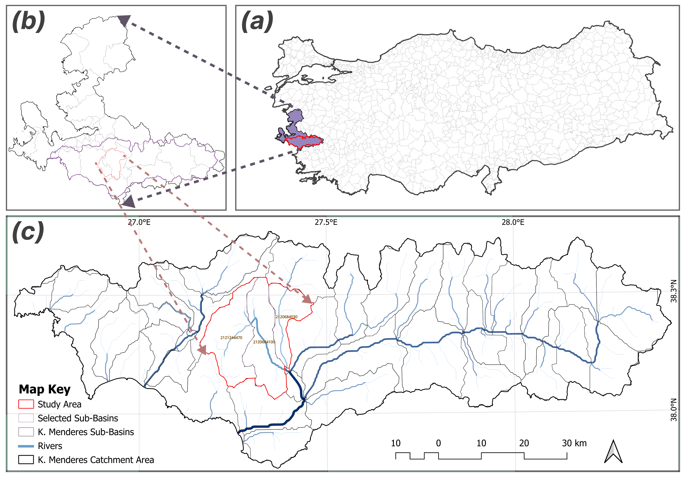
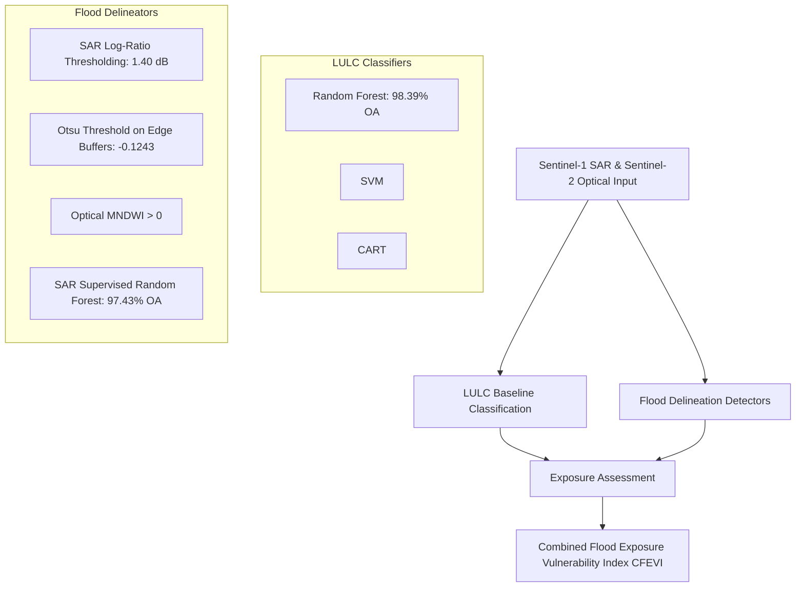

# Rapid Flood Extent Mapping and Exposure Assessment in the Küçük Menderes Basin, Türkiye

[](https://doi.org/10.1007/s11069-026-08292-6)
[](https://doi.org/10.1007/s11069-026-08292-6)
[](https://doi.org/10.1007/s11069-026-08292-6)
[](https://opensource.org/licenses/MIT)
[](https://creativecommons.org/licenses/by/4.0/)

This repository contains the cloud-native workflows, GEE scripts, hyper-parameter tuning code, and derived datasets developed for the study: **"Rapid flood extent mapping and exposure assessment using SAR and machine learning in the Küçük Menderes Basin, Türkiye"**, published in *Natural Hazards* (2026).

---

## 1. Study Overview & Core Claim

Floods are among the most destructive natural hazards in agricultural and low-lying deltaic environments. This study develops a **cloud-native, integrated remote sensing and machine learning workflow** designed for rapid flood-extent mapping and demographic/cropland exposure screening. 

By utilizing Sentinel-1 SAR and Sentinel-2 optical data on **Google Earth Engine (GEE)**, the workflow establishes a high-resolution Land-Use/Land-Cover (LU/LC) baseline and detects inundated surfaces using four complementary algorithms. 

The core claim is that combining multiple detection modalities (event-specific backscatter thresholding, optical index mapping, edge-buffer boundary optimization, and supervised machine learning) delivers a highly robust flood delineation system suitable for operational response and risk planning, even in the absence of dense in-situ validation networks.

---

## 2. Study Area & Event Context

The study focuses on the **Küçük Menderes River Basin** (İzmir, Türkiye), a low-lying, highly productive agricultural catchment vulnerable to seasonal storm events. The flood event evaluated occurred between **10–14 September 2024**.


*Figure 1: Location and regional context of the Küçük Menderes River Basin, Türkiye.*

---

## 3. Workflow & Methodology

The analytical framework consists of three main stages executed in GEE (JavaScript) and local Python environments:



### 3.1 Land-Use/Land-Cover (LU/LC) Baseline
- A multi-sensor composite (Aug–Sep 2024) is classified using Random Forest (RF), Support Vector Machine (SVM), and Classification and Regression Trees (CART).
- The RF classifier achieved the highest accuracy (**98.39% Overall Accuracy**) and was used as the exposure baseline.

### 3.2 Flood Delineation Modalities
1. **Fixed SAR Log-Ratio Thresholding:** A conservative cut at **1.40 dB** on pre/post-event backscatter difference to isolate major open-water zones.
2. **Otsu Edge-Buffer Detection:** Automated Otsu thresholding (**-0.1243**) applied to high-gradient backscatter boundaries, optimized with a shoreline buffer to capture mixed pixels.
3. **MNDWI Optical Delineation:** Sentinel-2 MNDWI index (**> 0**) to verify surface water where cloud cover allowed.
4. **Supervised SAR-RF Model:** A 50-tree Random Forest classifier trained on Sentinel-1 backscatter features, achieving **97.43% Overall Accuracy** on independent testing.

### 3.3 Exposure & Vulnerability Mapping
Mapped inundation footprints are intersected with the **Meta High-Resolution Settlement Layer (HRSL)** and the LU/LC baseline to quantify affected population and crop areas. These exposure metrics are aggregated into a **Combined Flood Exposure Vulnerability Index (CFEVI)** at the sub-district level.

---

## 4. Key Results

| Metric | Value | Reference |
| :--- | :--- | :--- |
| **LU/LC Classification Accuracy (RF)** | 98.39% Overall Accuracy (OA) | Figure 5, 7 |
| **Flood Mapping Accuracy (RF)** | 97.43% OA (F1-score water class) | Figure 6, 10 |
| **Population Exposed** | ~48,264 residents | Figure 12 |
| **Cropland Inundated** | ~523 hectares | Figure 12, 11 |
| **Cropland Share of Flood Extent** | ~79% – 81% (dominant category) | Figure 11 |

The spatial pattern of inundation shows high agreement with official situation reports (AFAD and ministerial impact maps) along major canal corridors and low-elevation agricultural zones.


*Figure 12: Integrated Exposure Analysis and Combined Flood Exposure Vulnerability Index (CFEVI) results.*

---

## 5. Repository Structure

```
├── gee/                       # Google Earth Engine JavaScript scripts
│   ├── lulc_rf-svm-cart_hypertune_normidx.js   # LU/LC baseline classification and hyper-parameter sweeps
│   ├── s1_log_ratio_flood.js                   # Sentinel-1 SAR log-ratio event thresholding
│   ├── otsu_mndwi.js                           # Otsu thresholding on SAR edges & MNDWI verification
│   └── simple_flood_exposure.js                # Population and land-cover exposure overlays
├── colab/                     # Hyper-parameter and ROC analytics (Python)
│   └── hyperparameter_roc.py                   # Plotting scripts for model tuning and ROC curves
├── data/                      # Tabular dataset summaries
│   ├── rf_test_scores.csv                      # Validation statistics for Random Forest baseline
│   ├── svm_kernel_cost.csv                     # Sweep data for Support Vector Machine kernels
│   ├── cart_test_scores.csv                    # Sweep data for CART decision tree models
│   ├── cfevi.csv                               # Output vulnerability index calculations
│   └── rf_feature_importance.csv               # Mean decrease in Gini index for baseline variables
├── figs/                      # High-resolution figures from the published paper
├── other/                     # Academic citation and bibtex templates
│   └── bibliography.bib                        # Standard BibTeX file for the paper
├── CITATION.cff               # CITATION metadata file for GitHub integration
├── LICENSE-MIT                # Code license file
└── LICENSE-CC-BY-4.0          # Data/figures license file
```

---

## 6. Getting Started

### 1. Land-Use Baseline (Google Earth Engine)
1. Open the [Google Earth Engine Code Editor](https://code.earthengine.google.com/).
2. Load the script in `gee/lulc_rf-svm-cart_hypertune_normidx.js`.
3. Modify the Area of Interest (AOI) boundary and training assets where marked `// TODO: UPDATE_ME`.
4. Run the script to train the LULC models and export the classified RF raster.

### 2. Flood Mapping & Exposure Overlay
- Execute `gee/s1_log_ratio_flood.js` for Sentinel-1 GRD SAR log-ratio thresholding.
- Execute `gee/otsu_mndwi.js` to compute the edge-buffer Otsu mask and compare with optical MNDWI inputs.
- Run `gee/simple_flood_exposure.js` to intersect the event flood footprint with demographic datasets (Meta HRSL) and the LULC baseline.

### 3. Hyper-parameter Visualization
- Adapt or run `colab/hyperparameter_roc.py` in Google Colab or a local Python environment.
- This script processes the CSV tables in `data/` to reproduce the model evaluation heatmaps and the 10-fold cross-validated ROC panels.

---

## 7. Figure Directory (Natural Hazards Article)

<details>
<summary>Click to view descriptions of the 12 figures published in the study</summary>

* **Figure 1:** Location map of study area. (a) Türkiye with İzmir highlighted; (b) provincial context and the Küçük Menderes districts.
* **Figure 2:** The overall methodology flowchart showing remote sensing inputs, classification models, flood detectors, and exposure overlay logic.
* **Figure 3:** Predictors used for LULC classification in the study sub-basins: (a) slope, (b) Bare Soil Index (BSI), (c) MNDWI, (d) NDVI, (e) elevation (DEM), and (f) NDBI.
* **Figure 4:** Hyperparameter-selection protocol for LULC classifiers, outlining training sample extraction and model parameter sweeps.
* **Figure 5:** LULC classification performance: (a) per-class F1-score comparison by model; (b) overall metrics (OA, Kappa, macro-F1).
* **Figure 6:** Model selection and discrimination sweeps: (a) RF trees x mtry grid; (b) SVM cost sweep by kernel; (c) CART max-nodes sweep; (d-f) 10-fold ROC curves.
* **Figure 7:** LULC maps and areal totals: (a) SVM; (b) CART; (c) RF; (d) stacked horizontal bars showing area by class (ha).
* **Figure 8:** RF interpretability: (a) SHAP beeswarm; (b) SHAP instance heatmap; (c) SHAP waterfall for an exemplar pixel; (d) Spearman correlation matrix of predictors.
* **Figure 9:** SAR-based flood maps. (a) Fixed-threshold footprint with pre/post-event scenes and log-ratio histogram; (b) Otsu edge-buffer footprint with edge detection layers.
* **Figure 10:** Complementary maps. (a) Optical MNDWI > 0 flood with event MNDWI, permanent-water mask, and histogram; (b) RF SAR-based flood map with ground control validation points.
* **Figure 11:** Affected land cover breakdown: (a) stacked bar of flooded-area percentages across RF-LULC classes; (b) percentage matrix heatmap.
* **Figure 12:** Integrated exposure analysis workflow and Combined Flood Exposure Vulnerability Index (CFEVI) sub-basin clusters.

</details>

---

## 8. Citation

If you use this codebase, the GEE workflows, or the derived data, please cite the published journal article:

### APA Format
> Eminoğlu, Y., & Erdin, H. E. (2026). Rapid flood extent mapping and exposure assessment using SAR and machine learning in the Küçük Menderes Basin, Türkiye. *Natural Hazards*, *122*(12), 511. https://doi.org/10.1007/s11069-026-08292-6

### BibTeX Format
```bibtex
@article{Eminoglu_Erdin_2026,
  title   = {Rapid flood extent mapping and exposure assessment using SAR and machine learning in the Küçük Menderes Basin, Türkiye},
  author  = {Eminoğlu, Yusuf and Erdin, Hilmi Evren},
  year    = {2026},
  journal = {Natural Hazards},
  volume  = {122},
  number  = {12},
  pages   = {511},
  doi     = {10.1007/s11069-026-08292-6},
  url     = {https://doi.org/10.1007/s11069-026-08292-6}
}
```

---

## 9. Contact & Academic Profiles

* **Yusuf Eminoğlu** — Research Assistant & PhD Candidate, Dokuz Eylül University  
  * **Email:** [yusuf.eminoglu@deu.edu.tr](mailto:yusuf.eminoglu@deu.edu.tr)
  * **Academic Profiles:** [ResearchGate Profile](https://www.researchgate.net/profile/Yusuf-Eminoglu) | [GitHub Profile](https://github.com/YusufEminoglu)
* **Hilmi Evren Erdin** — Department of City and Regional Planning, Dokuz Eylül University  
  * **Email:** [evren.erdin@deu.edu.tr](mailto:evren.erdin@deu.edu.tr)
